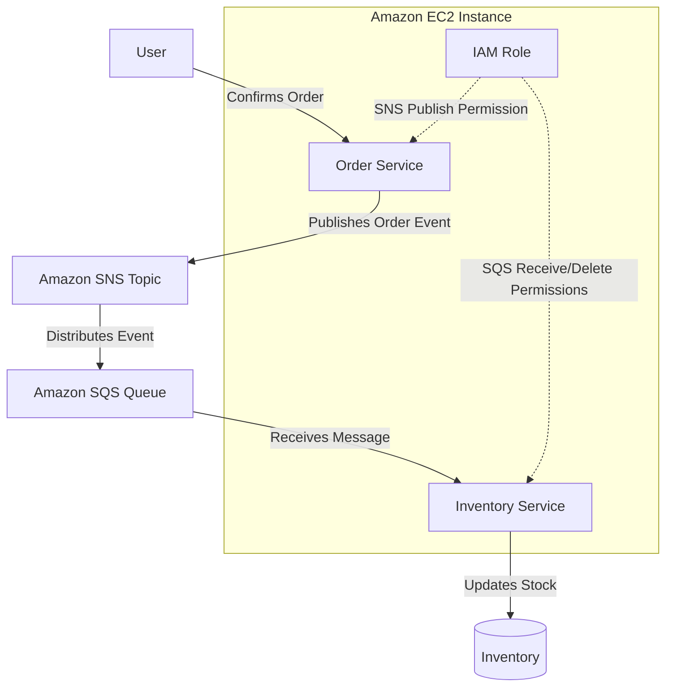

# AWS SNS and SQS Integration with Spring Boot Microservices

## 📌 Project Overview

This project demonstrates event-driven communication between two Spring Boot microservices using **Amazon SNS and Amazon SQS**.

When a user confirms an order, the Order Service publishes an order event to an Amazon SNS Topic. SNS distributes the event to an Amazon SQS Queue. The Inventory Service receives the message from SQS and updates the product stock.

Both microservices are deployed as Docker containers on a single Amazon EC2 instance.

## 🏗️ Architecture



### Architecture Components

| Component | Responsibility |
|---|---|
| Amazon EC2 | Hosts the application containers |
| Docker | Runs the microservices |
| Order Service | Creates and publishes order events |
| Amazon SNS | Distributes events to subscribed queues |
| Amazon SQS | Stores messages until consumers process them |
| Inventory Service | Receives events and updates inventory |
| AWS IAM Role | Provides secure access to AWS services |

## 🔄 Application Workflow

1. The user confirms an order.
2. The Order Service processes the order.
3. The Order Service creates an order event containing order details.
4. The Order Service publishes the event to the SNS Topic.
5. SNS distributes the event to the subscribed SQS Queue.
6. The Inventory Service receives the message from SQS.
7. The Inventory Service extracts the order details.
8. The Inventory Service updates the product stock.
9. After successful processing, the consumer deletes the message from SQS.

## 📩 Sample Order Event

The Order Service publishes an event like this:

```json
{
  "orderId": 1,
  "product": "books",
  "quantity": 2
}
```

The Inventory Service receives the event and processes it.

**Example output:**

```text
Received Order: 1
Product: books
Quantity: 2

Updating inventory for books
Reducing stock by 2

Inventory updated successfully!
```

## ☁️ AWS Services Configuration

### 1. Create an SNS Topic

1. Open the AWS Management Console.
2. Navigate to Amazon SNS.
3. Select Topics.
4. Click Create topic.
5. Select Standard.
6. Enter the topic name:

```text
SnsTopic
```

7. Create the topic.
8. Copy the Topic ARN.

Example:

```text
arn:aws:sns:ap-south-1:YOUR_ACCOUNT_ID:SnsTopic
```

### 2. Create an SQS Queue

1. Open Amazon SQS.
2. Click Create queue.
3. Select Standard.
4. Enter the queue name:

```text
SnsSpringboot
```

5. Create the queue.
6. Copy the Queue URL and ARN.

### 3. Subscribe SQS to SNS

1. Open the SNS Topic.
2. Select Create subscription.
3. Select Amazon SQS as the protocol.
4. Select the SQS Queue ARN.
5. Create the subscription.

Now SNS can distribute messages to the SQS Queue.

### 4. Configure the SQS Queue Policy

The SQS Queue must allow the SNS Topic to send messages.

Add a queue access policy similar to this:

```json
{
  "Version": "2012-10-17",
  "Statement": [
    {
      "Sid": "AllowSNSToSendMessage",
      "Effect": "Allow",
      "Principal": {
        "Service": "sns.amazonaws.com"
      },
      "Action": "sqs:SendMessage",
      "Resource": "YOUR_SQS_QUEUE_ARN",
      "Condition": {
        "ArnEquals": {
          "aws:SourceArn": "YOUR_SNS_TOPIC_ARN"
        }
      }
    }
  ]
}
```

Replace the placeholder ARNs with your actual SNS Topic ARN and SQS Queue ARN.

## 🔐 IAM Role Configuration

Instead of storing AWS access keys inside the application, this project uses an IAM Role attached to the EC2 instance.

### Required Permissions

The EC2 IAM Role needs permissions for both SNS and SQS because both containers are running on the same EC2 instance.

Example IAM policy:

```json
{
  "Version": "2012-10-17",
  "Statement": [
    {
      "Sid": "SNSPublishPermission",
      "Effect": "Allow",
      "Action": [
        "sns:Publish"
      ],
      "Resource": "YOUR_SNS_TOPIC_ARN"
    },
    {
      "Sid": "SQSConsumerPermission",
      "Effect": "Allow",
      "Action": [
        "sqs:GetQueueUrl",
        "sqs:GetQueueAttributes",
        "sqs:ReceiveMessage",
        "sqs:DeleteMessage",
        "sqs:ChangeMessageVisibility"
      ],
      "Resource": "YOUR_SQS_QUEUE_ARN"
    }
  ]
}
```

Attach this policy to the EC2 IAM Role.

**Important:** 
- The Order Service requires `sns:Publish`.
- The Inventory Service requires SQS permissions.
- The SQS queue policy separately allows SNS to send messages.
- Do not hardcode AWS access keys in your source code or Docker images.

## 🐳 Docker Deployment

Both Spring Boot microservices are packaged as Docker containers.

### Step 1: Build the Spring Boot Applications

Build the Order Service:

```bash
cd order-service
mvn clean package
```

Build the Inventory Service:

```bash
cd inventory-service
mvn clean package
```

### Step 2: Build and Start Containers

From the directory containing `docker-compose.yml`, run:

```bash
docker compose up --build -d
```

### Step 3: Check Running Containers

```bash
docker ps
```

### Step 4: View Application Logs

View all service logs:

```bash
docker compose logs -f
```

View Order Service logs:

```bash
docker compose logs -f producer-service
```

View Inventory Service logs:

```bash
docker compose logs -f consumer-service
```

### Step 5: Stop Containers

```bash
docker compose down
```

## 📁 Project Structure

Example project structure:

```text
AWS-SNS-SQS-Microservices/
│
├── order-service/
│   ├── src/
│   ├── pom.xml
│   └── Dockerfile
│
├── inventory-service/
│   ├── src/
│   ├── pom.xml
│   └── Dockerfile
│
├── docker-compose.yml
│
└── README.md
```

## 🛠️ Technologies Used

- Java
- Spring Boot
- Spring Cloud AWS
- Amazon SNS
- Amazon SQS
- Amazon EC2
- AWS IAM
- Docker
- Docker Compose
- Maven

## 🎯 Key Learnings

Through this project, I learned:

- How to integrate Spring Boot microservices with AWS SNS and SQS.
- How to implement event-driven communication.
- How SNS distributes events to SQS queues.
- How a consumer service receives and processes messages.
- How to deploy multiple Docker containers on an EC2 instance.
- How to configure IAM Roles and policies for secure AWS access.
- How to troubleshoot AWS credentials and authorization errors.

## 🚀 Future Improvements

- Deploy services independently using Amazon ECS and Fargate.
- Add multiple SQS queues for different consumer services.
- Implement Dead Letter Queues (DLQ) for failed messages.
- Add retry handling and idempotent event processing.
- Integrate Amazon CloudWatch for monitoring and logging.

## 👩‍💻 Author

**Manjula G**

GitHub: https://github.com/MNAJULAG7

LinkedIn: https://www.linkedin.com/in/manjula-g/

---

⭐ If you find this project useful, feel free to explore the repository!
